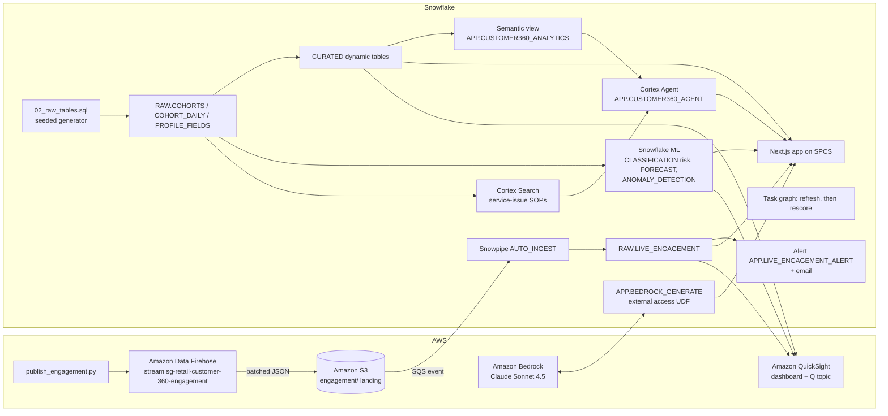

# Singapore Retail Customer 360 - Loyalty Cohort Retention

Customer 360 retention monitoring for **48 fictional loyalty cohorts of Kopi Lane Retail, a fictional Singapore omnichannel retailer** with malls and an online store, across five real Singapore planning areas (Orchard, Tampines, Jurong East, Woodlands, Punggol). Each cohort is an aggregate group of loyalty members in one planning area and one shopper segment; no individual customer records exist. All amounts are in SGD. Snowflake, optionally with AWS, takes the retention team from a live service issue to a 7-day churn risk score per cohort, an alert email and an AI action memo.

## Architecture

The pipeline runs on **Snowflake** (Dynamic Tables, Snowflake ML, Cortex Search, Cortex Agent, Cortex AI_COMPLETE, SPCS) and, in the full build, also uses **AWS** (Amazon Data Firehose, S3, Bedrock Claude, QuickSight + Amazon Q). Loyalty engagement events arrive in `RAW.LIVE_ENGAGEMENT`. Dynamic tables roll 90 days of cohort-day rows into purchases, revenue in SGD, service issues, churned members, unsubscribes, issue-free purchase rate and CRM touch compliance. Snowflake ML predicts which cohorts are likely to have a churn event in the next 7 days, forecasts service issues across the retailer and flags unusual return rates. A Cortex Agent answers with SQL and SOP citations, and an LLM drafts the retention team's action memo.

Interactive diagrams (hover for object names): [Snowflake only](docs/architecture-snowflake.html) | [AWS + Snowflake](docs/architecture-aws.html). The app's Architecture & Data tab shows both, the current build first. Regenerate them with `python3 docs/build_architecture.py`.



In the Snowflake-only build there is no AWS subgraph: `APP.SIMULATE_ENGAGEMENT` writes to `RAW.LIVE_ENGAGEMENT`, and the app calls Cortex `AI_COMPLETE` in place of the Bedrock UDF.

## Snowflake Capabilities

| Capability | Implementation |
|-----------|---------------|
| Dynamic Tables | `CURATED.KPI_SUMMARY`, `PERFORMANCE_SUMMARY`, `ISSUE_SUMMARY`, `TREND_ANALYSIS`, built from the RAW tables |
| Snowflake ML | CLASSIFICATION of 7-day churn risk (`ML.CHURN_RISK_SCORES`), a 14-day service-issue FORECAST, and return rate ANOMALY_DETECTION |
| Cortex Search | 14 synthetic service-issue SOPs (one per shopper segment and issue type) in `SEARCH.ISSUE_SOP_SEARCH` |
| Semantic View | `APP.CUSTOMER360_ANALYTICS` over cohorts, issue types, daily totals and risk |
| Cortex Agent | `APP.CUSTOMER360_AGENT`: Cortex Analyst over the semantic view, plus Cortex Search for SOP citations |
| Cortex AI | `AI_COMPLETE('claude-sonnet-4-5')` for grounded answers, and for the action memo in the Snowflake-only build |
| Alerts + Tasks | `APP.LIVE_ENGAGEMENT_ALERT` logs ISSUE events and sends email; task graph `TASK_REFRESH_CURATED`, then `TASK_RESCORE_RISK` |
| Snowpark Container Services | Next.js app `APP.SG_RETAIL_CUSTOMER_360_APP` with 6 tabs: Executive Cockpit, Predictive, Controls, Live Engagement, Ask AI, Architecture & Data |
| Snowpipe | `RAW.LIVE_ENGAGEMENT_PIPE` AUTO_INGEST from S3 (AWS build only) |

## AWS Services

These run only in the AWS + Snowflake build.

| Service | Role in Demo |
|---------|-------------|
| Amazon Data Firehose | Direct PUT stream `sg-retail-customer-360-engagement` takes simulated engagement events and writes them to S3 in batches |
| Amazon S3 | Landing bucket (`engagement/`); an event notification goes to the Snowpipe SQS queue |
| Amazon Bedrock | Claude Sonnet 4.5 drafts the action memo, called from Snowflake through an external-access UDF |
| Amazon QuickSight | DIRECT_QUERY cohort retention dashboard over Snowflake (daily service issues, churned members by cohort, churn risk) |
| Amazon Q | Natural-language questions over the QuickSight topic `sg-retail-customer-360-topic` |
| AWS IAM | Least-privilege roles for S3, Firehose and Bedrock |

## Personas

Both personas work for Kopi Lane Retail and are fictional.

| Persona | Role | Key Questions |
|---------|------|---------------|
| **Wen Hui Chua** | Head of Customer Retention | "How many purchases go through without a service issue?" "Which issue types end in churn most often?" |
| **Hafiz Osman** | CRM and Loyalty Analyst | "Which cohorts need a retention review this week, and what does the SOP say to do?" |

## Data

Every table is synthetic, aggregate and HASH-seeded, so a rebuild reproduces it. The retailer, its cohorts and all names are fictional; the five planning areas are real Singapore planning areas used only as regions. There are no individual customer records.

| Table | Rows | Description |
|-------|------|-------------|
| RAW.COHORTS | 48 | Loyalty cohorts in 5 Singapore planning areas (9 or 10 each) and 5 shopper segments (Value shoppers, Premium loyalists, Family shoppers, Young professionals, Occasional gifters), with a retention risk tier and average membership tenure |
| RAW.COHORT_DAILY | 4,320 | One row per cohort per day for 90 days: purchases, revenue (SGD), service issues, churned members, unsubscribes, issue type, CRM touches due and done, return rate and service response time |
| RAW.PROFILE_FIELDS | 48 | Required, filled and pending loyalty profile fields per cohort |
| SEARCH.ISSUE_DOCS | 14 | Synthetic service-issue SOPs indexed for Cortex Search |
| RAW.LIVE_ENGAGEMENT | Grows during the demo | Live engagement events from Firehose (AWS build) or `APP.SIMULATE_ENGAGEMENT` (Snowflake-only build) |
| ML.CHURN_RISK_SCORES | 48 | 7-day churn probability and risk band per cohort |

## Build Instructions

### Prerequisites
- Snowflake account with ACCOUNTADMIN access, and Cortex AI enabled (AI_COMPLETE, Search, Agent).
- An X-Small warehouse with auto-suspend at or below 120 s, and an existing SPCS compute pool.
- Python 3.11+, `snowflake-connector-python`, Node.js 22+, Docker and the `snow` CLI.
- App image: run `snow spcs image-registry login`, then build and push `sg-retail-customer-360-app:v1` to the database's `APP.IMAGES` repository (see the header of `snowflake/07_deploy_app.sql`).
- AWS build only: `boto3`, AWS credentials for the target account (us-west-2) with Bedrock access, and QuickSight Enterprise.

### SPCS App
```
<DATABASE>.APP.SG_RETAIL_CUSTOMER_360_APP
```

### Tests
```bash
python -m pytest aws snowflake quicksight
```

For a local run, put `SNOWFLAKE_ACCOUNT`, `SNOWFLAKE_USER`, `SNOWFLAKE_DATABASE`, `SNOWFLAKE_WAREHOUSE`, `SNOWFLAKE_AUTHENTICATOR=PROGRAMMATIC_ACCESS_TOKEN`, `SNOWFLAKE_TOKEN` and `DEMO_PLATFORM` in the environment, then run `npm --prefix app run build && npm --prefix app start`.

## Build Modes

The two modes run on one shared core and differ in three layers. The `DEMO_PLATFORM` value in the app SPCS spec selects the memo provider and the Live Engagement copy.

| Layer | Snowflake Only | Full AWS + Snowflake |
|---|---|---|
| Live engagement | `CALL APP.SIMULATE_ENGAGEMENT(n)` inserts simulated engagement events into `RAW.LIVE_ENGAGEMENT`. This simulates an engagement feed; it is not Snowpipe Streaming | `aws/publish_engagement.py` to Amazon Data Firehose, then S3, SQS and Snowpipe AUTO_INGEST |
| Action memo | Cortex `AI_COMPLETE('claude-sonnet-4-5')` | Amazon Bedrock Claude Sonnet 4.5 through `APP.BEDROCK_GENERATE` |
| BI and natural-language questions | The SPCS app is the dashboard; questions go to the Cortex Agent | Also a QuickSight dashboard and an Amazon Q topic |
| App setting | `DEMO_PLATFORM: snowflake` | `DEMO_PLATFORM: aws` |

### Snowflake Only

```bash
# 1. Core data and dynamic tables (guarded: new isolated database only)
python snowflake/run_core.py --database SINGAPORE_RETAIL_CUSTOMER_360_SNOWFLAKE --warehouse <XS_WAREHOUSE> --connection <CONNECTION> --apply
# 2. Native engagement feed, ML, search, semantic view, agent, alert and task graph
python snowflake/run_intelligence.py --database SINGAPORE_RETAIL_CUSTOMER_360_SNOWFLAKE --platform snowflake --warehouse <XS_WAREHOUSE> --connection <CONNECTION> --alert-email you@example.com
# 3. App on SPCS with DEMO_PLATFORM=snowflake (push the image first)
python snowflake/run_intelligence.py --database SINGAPORE_RETAIL_CUSTOMER_360_SNOWFLAKE --platform snowflake --warehouse <XS_WAREHOUSE> --connection <CONNECTION> --alert-email you@example.com --files 07_deploy_app.sql --compute-pool <COMPUTE_POOL>
```

During the demo:
- Run `CALL APP.SIMULATE_ENGAGEMENT(20)` to add live engagement events. For a continuous feed, run `ALTER TASK APP.TASK_SIMULATE_ENGAGEMENT RESUME`, and `SUSPEND` it afterwards.
- Run `EXECUTE ALERT APP.LIVE_ENGAGEMENT_ALERT` to raise the alert email.
- Run `EXECUTE TASK APP.TASK_REFRESH_CURATED` to refresh the curated tables and rescore risk.

Afterwards, drop the database or run `ALTER SERVICE APP.SG_RETAIL_CUSTOMER_360_APP SUSPEND`.

### Full AWS + Snowflake

```bash
# 1. Core data and dynamic tables (guarded: new isolated database only)
python snowflake/run_core.py --database SINGAPORE_RETAIL_CUSTOMER_360_AWS --warehouse <XS_WAREHOUSE> --connection <CONNECTION> --apply
# 2. AWS ingestion and Bedrock (dry run first, then --apply)
python aws/setup_aws.py --database SINGAPORE_RETAIL_CUSTOMER_360_AWS --account <AWS_ACCOUNT_ID> --connection <CONNECTION> --apply
# 3. ML, search, semantic view, agent, alert and task graph
python snowflake/run_intelligence.py --database SINGAPORE_RETAIL_CUSTOMER_360_AWS --platform aws --warehouse <XS_WAREHOUSE> --connection <CONNECTION> --alert-email you@example.com
# 4. App on SPCS with DEMO_PLATFORM=aws (push the image first)
python snowflake/run_intelligence.py --database SINGAPORE_RETAIL_CUSTOMER_360_AWS --platform aws --warehouse <XS_WAREHOUSE> --connection <CONNECTION> --alert-email you@example.com --files 07_deploy_app.sql --compute-pool <COMPUTE_POOL>
# 5. QuickSight dashboard and Q topic (needs an existing Snowflake data source)
python quicksight/build_dashboards.py --database SINGAPORE_RETAIL_CUSTOMER_360_AWS --account <AWS_ACCOUNT_ID> --principal-arn <QUICKSIGHT_USER_ARN> --data-source-arn <DATA_SOURCE_ARN> --prefix sg-retail-customer-360 --apply --update --with-topic
```

QuickSight objects must be shared with the QuickSight user who signs in (`--principal-arn`); otherwise the console shows nothing.

During the demo:
- Run `python aws/publish_engagement.py --count 20` to send live engagement events. Firehose buffers for up to 60 seconds before writing to S3.
- Run `EXECUTE ALERT APP.LIVE_ENGAGEMENT_ALERT` to raise the alert email.
- Run `EXECUTE TASK APP.TASK_REFRESH_CURATED` to refresh the curated tables and rescore risk.


When you are done, `python aws/teardown_aws.py --database SINGAPORE_RETAIL_CUSTOMER_360_AWS --account <AWS_ACCOUNT_ID> --connection <CONNECTION> --apply` deletes the AWS resources plus the account-level Bedrock external-access and S3 storage integrations. The email integration `SG_RETAIL_CUSTOMER_360_EMAIL_INT` stays, because the Snowflake-only build uses it too.

## Business Impact

Industry research and a Snowflake customer outcome:
- **Retention is cheaper than acquisition**: "acquiring a new customer is anywhere from five to 25 times more expensive than retaining an existing one" -- [Harvard Business Review, The Value of Keeping the Right Customers](https://hbr.org/2014/10/the-value-of-keeping-the-right-customers)
- **Small retention gains matter**: the same article cites research by Frederick Reichheld of Bain & Company "that shows increasing customer retention rates by 5% increases profits by 25% to 95%" -- [Harvard Business Review, The Value of Keeping the Right Customers](https://hbr.org/2014/10/the-value-of-keeping-the-right-customers)
- **Tapestry** (Snowflake customer) runs its self-service customer analytics platform Apollo on Snowflake: "Another team at Coach found they could uncover who was a new multi-channel customer and what drove them to make their first purchase in a retail channel." -- [Snowflake customer story: Tapestry](https://www.snowflake.com/en/customers/all-customers/case-study/tapestry/)

## Key Demo Numbers

All figures are synthetic and come from the seeded demo data. Forecast and anomaly figures can shift slightly with the build day.

- **48 loyalty cohorts** in 5 Singapore planning areas and 5 shopper segments, 4,320 cohort-days over 90 days: **1,385,499 purchases** worth SGD 107.7 M revenue
- **Issue-free purchase rate 99.94%**: **775 service issues**, of which **164** ended with members churning (issue churn rate 21.2%), and **79 unsubscribes**
- **Points not credited** causes the most churned members (47 of 200 issues); the 19 mall checkout outage issues (Jurong East and Woodlands) were all resolved with the members retained
- Cohorts in **Woodlands** have the most churned members (66); Tampines and Punggol have the fewest (21 each)
- **Churn model**, out-of-time holdout: precision 0.36 and recall 0.28 at a 0.5 threshold, against a 0.20 base rate. 6 cohorts are high risk; the top one, COH-0013 in Woodlands, scores 94.5%
- **14-day service-issue forecast** with prediction intervals; **62 of 768** recent cohort-days flagged as return rate anomalies
- **CRM touch compliance 73.7%**; profile completeness 54.1%, with 28 profile fields pending
- **14 SOPs** indexed in Cortex Search and cited by ID in agent answers

## License

Apache 2.0 — See [LICENSE](LICENSE) for details.

This is a personal demo project and is not an official Snowflake offering. It comes with no support or warranty. Industry metrics cited are from publicly available third-party research and Snowflake customer stories; they represent reported outcomes and are not guarantees of results. All companies, cohorts and personas in the demo are fictional.
